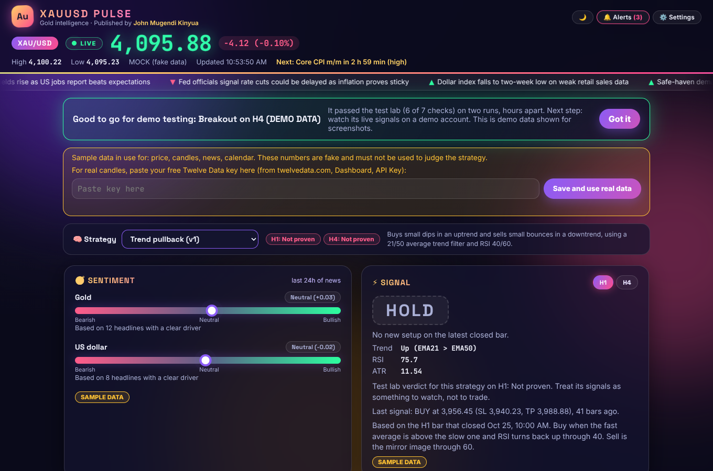
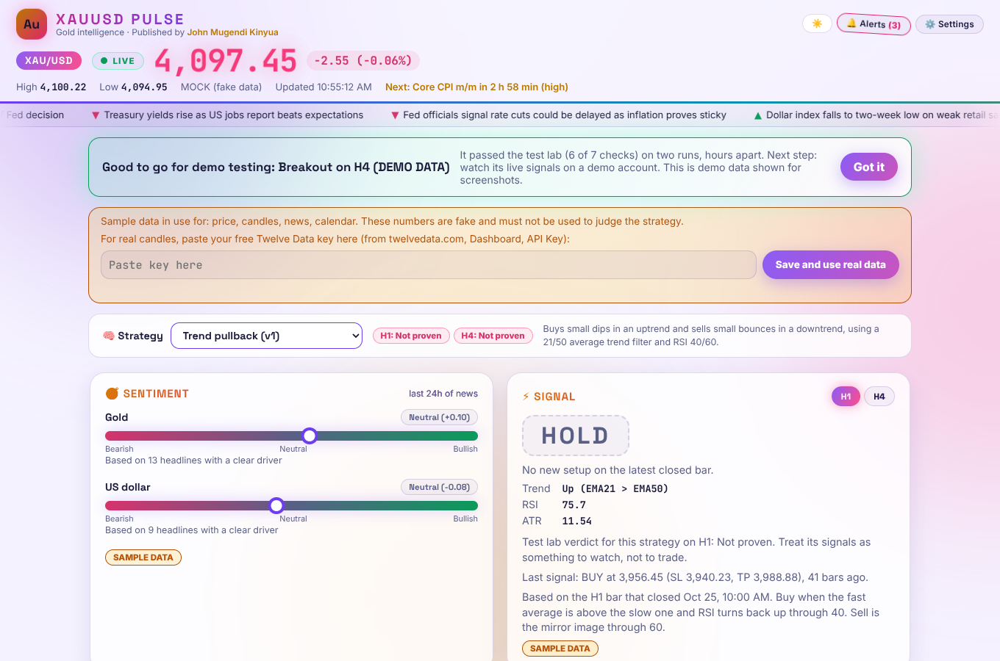
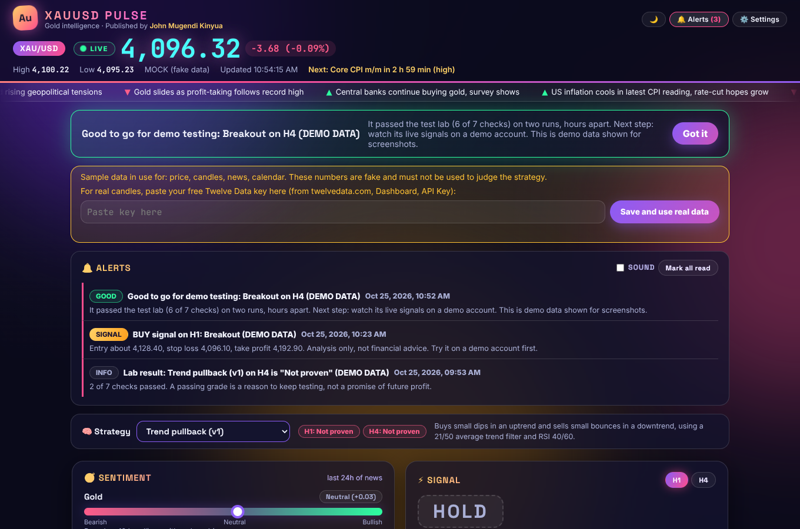
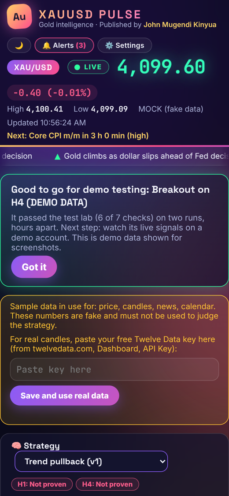
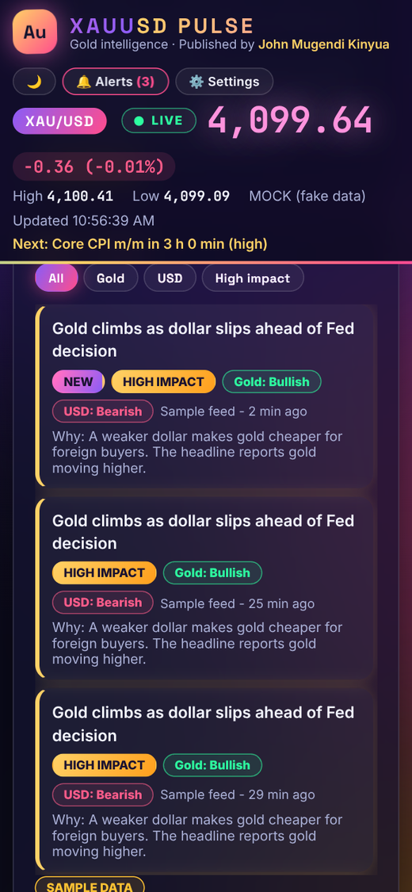
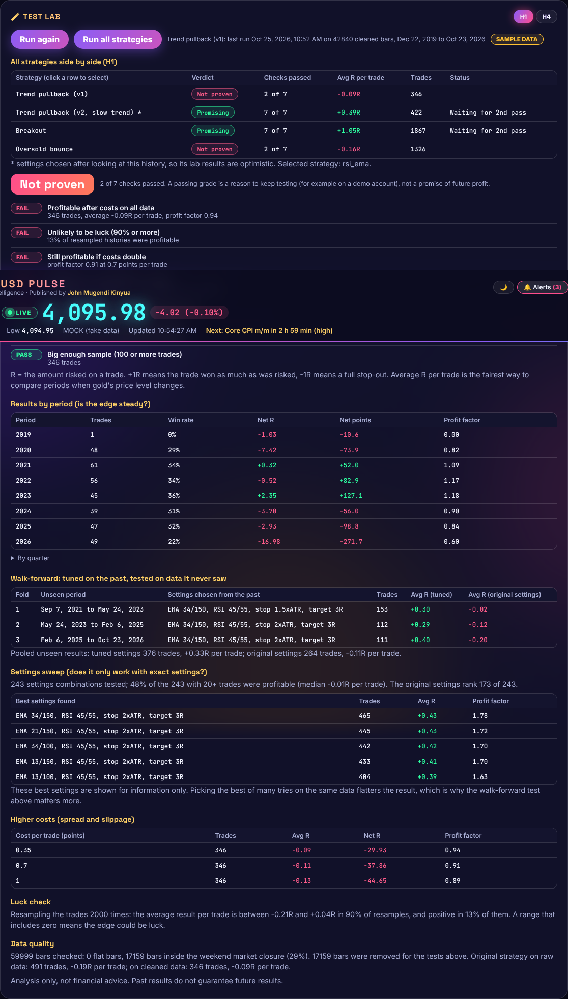
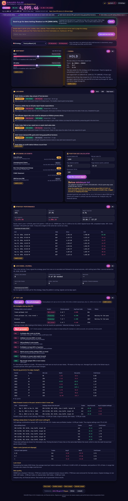
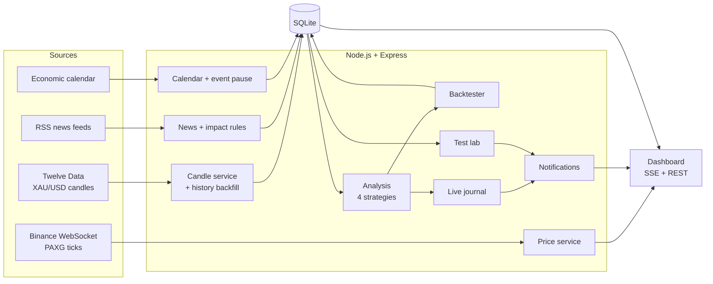

<div align="center">

# XAUUSD Pulse

**A live gold intelligence dashboard: real-time price, news that explains itself, four strategies, an honest test lab and on-site alerts.**

[](https://github.com/JohnMugen1/xauusd-pulse/actions/workflows/ci.yml)


Published by **[John Mugendi Kinyua](https://github.com/JohnMugen1)**



<sub>Screenshots use the built-in demo data (not real market data).</sub>

</div>

---

## Contents
[Why this project](#why-this-project) · [Features](#features) · [Screenshots](#screenshots) · [How it works](#how-it-works) · [Quick start](#quick-start) · [Configuration](#configuration) · [Strategies](#the-four-strategies) · [Test lab](#the-test-lab-is-the-edge-real-or-luck) · [Alerts and journal](#alerts-and-the-live-journal) · [Data sources](#data-sources-and-free-tier-budget) · [API](#api) · [Project structure](#project-structure) · [Testing](#testing) · [Security](#security-and-privacy) · [Limitations](#honest-limitations) · [Roadmap](#roadmap) · [Author](#author)

## Why this project
Most trading dashboards show signals and stop there. The hard question is whether the signals can be trusted. **XAUUSD Pulse is built around that question.** Every strategy is put through a seven-check test lab (walk-forward testing on unseen data, a settings sweep, higher-cost tests, a bootstrap luck check) and then followed live in a journal with nothing back-filled. A strategy only earns a "good to go" message after it passes twice, hours apart, on real data.

In my own first runs on real gold data the original strategy came out **"Not proven"**. The project reports that plainly. Finding out *before* risking money is the point.

## Features
| | |
|---|---|
| **Live price ticker** | Binance public WebSocket (PAXG, a gold-backed token) with automatic reconnect and a stale-data watchdog; glow and flash on every move |
| **News that explains itself** | Free RSS feeds scored by transparent rules: each headline is tagged bullish, bearish or neutral for gold and for the dollar, with a plain-English reason |
| **Sentiment gauges** | Recency-weighted gold and dollar sentiment from the last 24 hours |
| **Four strategies** | Trend pullback v1 and v2, breakout, oversold bounce, all on one backtesting engine |
| **Test lab** | Data-quality check, results by year and quarter, walk-forward test, 243-setting sweep, cost stress test, bootstrap luck check, seven-check verdict |
| **Live signal journal** | Every real signal recorded and followed to its outcome (forward test), with CSV export |
| **On-site alerts** | Bell, banner and optional sound. "Good to go" needs two passes at least 12 hours apart; live signal alerts only for passing strategies |
| **Event pause** | Signals show PAUSED around high-impact US events (CPI, NFP, FOMC) |
| **Position-size calculator** | Lots from balance, risk % and the signal's stop, with minimum-lot warnings |
| **8 years of history** | Loaded in the background in pages, paced for the free plan |
| **Neon glass UI** | Animated background, headline tape, dark and light themes, mobile friendly, local fonts (works offline), respects reduced-motion |
| **$0 to run** | Free data sources, SQLite, no cloud account needed |

## Screenshots
| Dark | Light |
|---|---|
|  |  |

| Alerts | Mobile |
|---|---|
|  |   |

<details><summary>Test lab and full page</summary>





</details>

## How it works

Everything reaches the browser through one Server-Sent Events stream plus small REST endpoints. The server is the only thing that talks to data providers, which protects free-tier limits and keeps API keys off the browser.

## Quick start
**Windows (easiest):** install [Node.js LTS](https://nodejs.org), then double-click **`START.bat`**. Your browser opens at http://127.0.0.1:3000.

**Any system:**
```bash
git clone https://github.com/JohnMugen1/xauusd-pulse.git
cd xauusd-pulse
npm install
cp .env.example .env      # Windows: copy .env.example .env
npm start
```
Open http://127.0.0.1:3000.

**Real candles (free):** get a key at [twelvedata.com](https://twelvedata.com), then click **Settings** in the dashboard and paste it (or run `SET-KEY.bat`). Without a key the app runs on clearly labelled sample data. After the key is saved, up to 8 years of history load in the background.

## Configuration
Settings live in `.env` (copy from `.env.example`). Everything is optional.

| Variable | Default | Meaning |
|---|---|---|
| `PORT`, `HOST` | `3000`, `127.0.0.1` | Where the server listens (local only by default) |
| `TWELVEDATA_API_KEY` | empty | Free key for real candles; empty means sample data |
| `PRICE_SOURCE` | `binance` | `binance` (live) or `mock` (fake ticks for offline use) |
| `NEWS_SOURCE`, `CALENDAR_SOURCE` | `rss`, `faireconomy` | Use `sample` for offline demo data |
| `TIMEFRAMES` | `H1,H4` | Candle timeframes analysed |
| `HISTORY_YEARS` | `8` | How much candle history to load |
| `EVENT_PAUSE`, `EVENT_PAUSE_BEFORE_MIN`, `EVENT_PAUSE_AFTER_MIN`, `EVENT_PAUSE_IMPACT` | `on`, `30`, `30`, `high` | Event pause window |
| `LAB_AUTO` | `on` | Re-run the test lab about once a day |
| `NEWS_FEEDS` | built-in list | Comma-separated RSS URLs to replace the defaults |
| `DB_PATH` | `data/xauusd.db` | SQLite file |

## The four strategies
| Strategy | Idea |
|---|---|
| **Trend pullback v1** | Buy dips in an uptrend (21/50 averages, RSI back through 40); sell bounces in a downtrend |
| **Trend pullback v2** | Same idea, slower trend (21/100), RSI 45/55, wider stop and 3R target. *Settings were chosen after seeing the history, so its lab results are optimistic* |
| **Breakout** | Buy a close above the recent high in an uptrend; sell below the recent low in a downtrend |
| **Oversold bounce** | Mean reversion: buy when RSI recovers from oversold, sell when it falls back from overbought |

All share one engine: signal at a bar's close, entry at the next bar's open (no look-ahead), stop and target from ATR, one trade at a time, costs charged on every trade, and a bar touching both stop and target counts as a stop.

## The test lab: is the edge real or luck?
Seven checks, each PASS or FAIL: profitable after costs; unlikely to be luck (bootstrap, 90%+); still profitable if costs double; profitable in 60%+ of quarters; works across nearby settings (60%+); profitable on unseen data (walk-forward); sample of 100+ trades. Results are measured in **R** (units of risk) so 2024 and 2026 compare fairly even though gold's price level changed. Verdict: **Promising** (6-7 passes), **Mixed** (4-5) or **Not proven**.

## Alerts and the live journal
- **Good to go** appears only after a strategy passes the lab on two runs at least 12 hours apart. It means *ready for a demo account*, not "will make money".
- **Live signal alerts** appear only for strategies that currently pass. Signals inside event-pause windows show as "on hold".
- The **journal** records signals from the moment it starts, never back-fills, and follows each to its real outcome; 20 completed trades trigger a live-results message.
- Results on sample (fake) data never raise alerts and are discarded when real data loads.

## Data sources and free-tier budget
| Data | Source | Notes |
|---|---|---|
| Live price | Binance public WebSocket, PAXG/USDT | Gold-backed token; tracks gold closely but is not spot XAUUSD |
| Candles | Twelve Data free plan | About 220 requests a day (limit 800); history loading is a one-off of roughly 15 |
| News | Google News RSS searches, FXStreet, Federal Reserve | Polled every 2 minutes |
| Calendar | FairEconomy weekly JSON | US high and medium impact events |

Free-tier terms change; re-check them before relying on any limit.

## API
| Endpoint | Purpose |
|---|---|
| `GET /api/stream` | Server-Sent Events: live ticks and update notices |
| `GET /api/status` `/api/health` `/api/price` | Health, data-source status, latest tick |
| `GET /api/strategies` | Strategies with lab verdicts and live-journal summaries |
| `GET /api/signal?tf=&strategy=` | Latest signal (includes event-pause state) |
| `GET /api/performance?tf=&strategy=` | Backtest summary and trades |
| `GET /api/journal?tf=&strategy=` | Live journal summary and recent rows |
| `GET /api/lab?tf=&strategy=` `/api/lab/summary?tf=` | Test lab results |
| `POST /api/lab/run?tf=&strategy=` | Start a lab run (`strategy=all` for every strategy; local only) |
| `GET /api/news?filter=` `/api/sentiment` `/api/events` `/api/pause` | News, sentiment, calendar, pause state |
| `GET /api/notifications` · `POST /api/notifications/read` | On-site alerts |
| `GET /api/export/journal.csv` `/api/export/trades.csv` | CSV downloads |
| `GET /api/debug/backtest?tf=&strategy=` | Data-quality and signal check |
| `POST /api/settings/twelvedata-key` | Validate and save the API key (local only) |

## Project structure
```
src/
  server.js            wiring, SSE stream, scheduling
  api.js               REST endpoints
  config.js            settings from .env
  db.js                SQLite schema and upgrades
  lib/                 indicators, news impact rules, sentiment, sample data, CSV
  strategy/            four strategies and the pure backtest engine
  lab/                 data quality, statistics, walk-forward test lab, verdict logic
  services/            price, candles (+history), analysis, backtest, news,
                       calendar, event pause, journal, notifications, lab service
public/                dashboard (HTML, CSS, JS, position calculator, local fonts)
tests/                 70 automated tests
docs/                  documentation PDF, screenshots, publishing guide
```

## Testing
```bash
npm test
```
70 automated tests cover indicators, every strategy (including a no-look-ahead check), the backtest engine, the lab (walk-forward folds never overlap training data), journal results matching the backtest trade for trade, notifications, event pause, history loading, CSV and the calculator. Integration checks were run against local fake servers for Twelve Data, RSS and the calendar, and the dashboard was checked in a headless browser.

## Security and privacy
- Listens on `127.0.0.1` only by default; no accounts, no tracking, no cloud.
- The API key stays on the server and in your local `.env` (git-ignored); it is never sent to the browser or written to logs.
- State-changing endpoints reject non-local hosts and foreign origins (DNS-rebinding and cross-site protection).
- All text from feeds is inserted with `textContent`, never as HTML; links are limited to `http(s)`.

## Honest limitations
- No strategy here is proven to be profitable; the lab and the journal exist to find that out. **Not financial advice.**
- PAXG is a proxy for spot gold. News impact uses keyword rules on headlines only.
- Event pause is not covered by the lab (the calendar has no history).
- Free data sources can change or rate-limit; always-on hosting is not included yet.

## Roadmap
Free always-on hosting, a calendar "surprise" tag (actual versus forecast), settings page for strategy parameters, backups, richer news sources.

## Built with
Node.js, Express, SQLite (better-sqlite3), Server-Sent Events, vanilla JavaScript, CSS animations, rss-parser, ws. Developed with Claude as an AI pair-programmer for design, review and testing.

## Author
**John Mugendi Kinyua**, software engineer based in Nairobi, Kenya.
[GitHub](https://github.com/JohnMugen1) · [LinkedIn](https://www.linkedin.com/in/john-mugendi-820018378/)

## License
MIT, see [LICENSE](LICENSE). This software is for personal and educational use and provides analysis, not financial advice.
